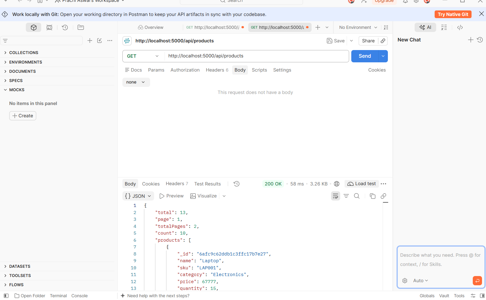
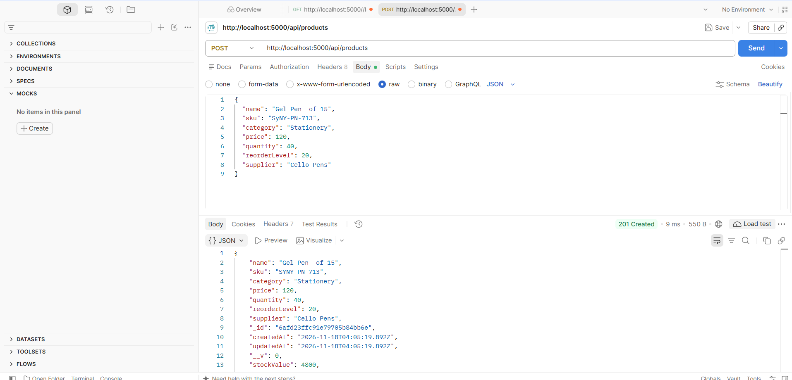
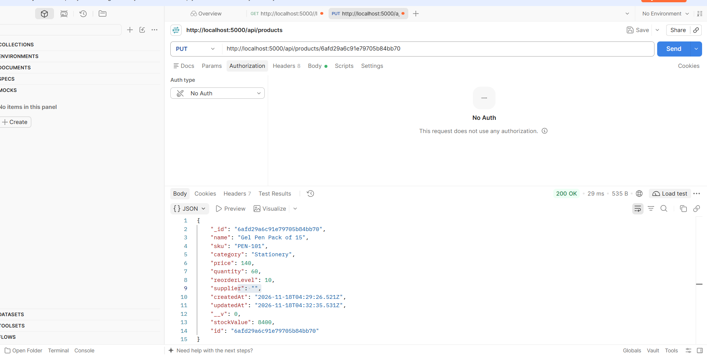
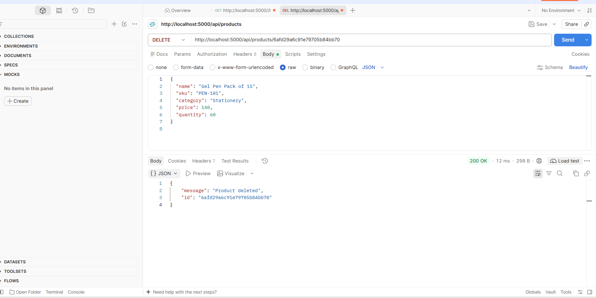
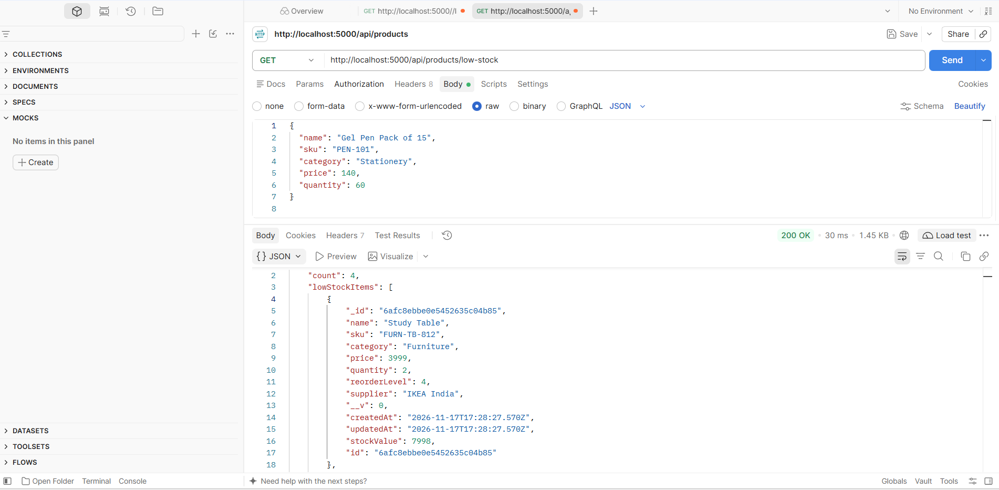
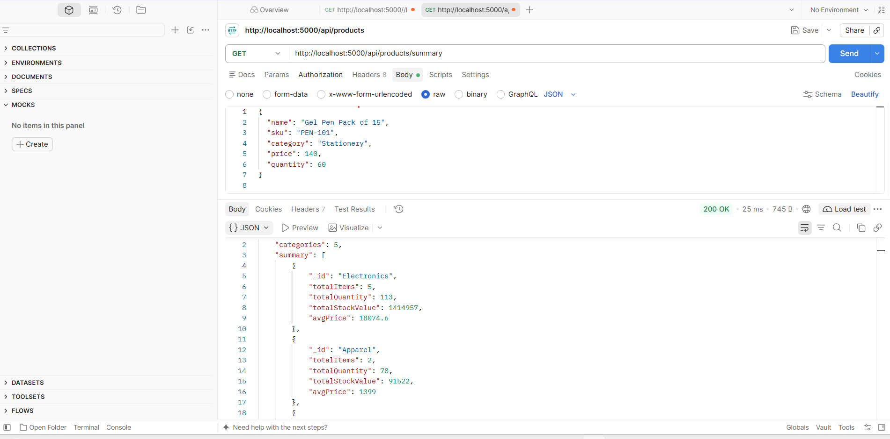
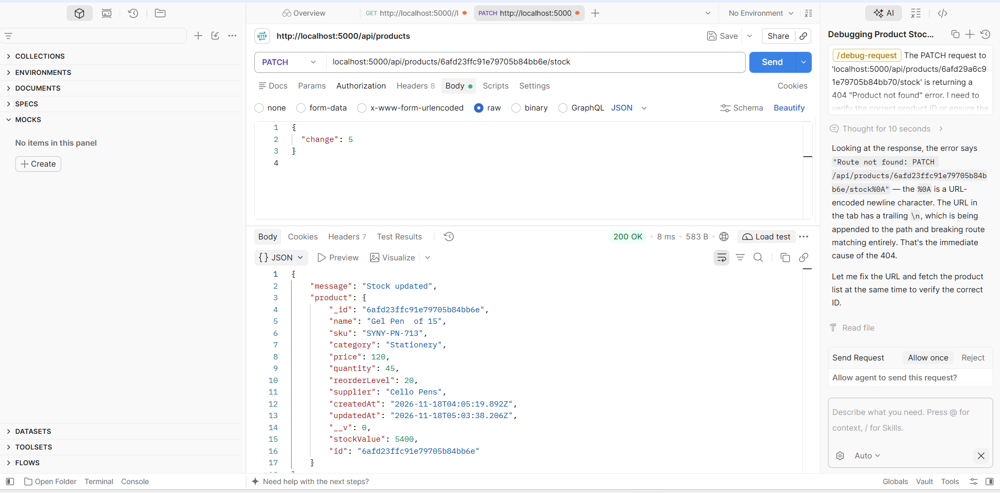

# Assignment 3: Inventory and Data Management System

RESTful backend for managing a product catalogue, built with **Node.js, Express.js, MongoDB (Mongoose) and dotenv**.

## Features
- Mongoose schema with field-level validation (required, min/max, enum, unique SKU, integer checks)
- Full CRUD for products
- Filtering, searching, sorting and pagination via query strings
- Safe (atomic) stock increase/decrease - stock can never go below zero
- Aggregation pipelines: Low-Stock report and Category-wise summary
- Centralized error handling + ObjectId validation middleware
- Config through environment variables (dotenv)

## Project Structure
```
├── config/db.js
├── controllers/productController.js
├── middleware/ (errorHandler.js, validateObjectId.js)
├── models/Product.js
├── routes/productRoutes.js
├── utils/ (AppError.js, asyncHandler.js)
├── screenshots/            <- Postman screenshots
├── seed.js                 <- sample data
├── server.js
├── .env.example
└── package.json
```

## Setup
```bash
npm install
cp .env.example .env     # then edit MONGO_URI if needed
npm run seed             # optional: inserts 12 sample products
npm run dev              # or: npm start
```
Server runs on `http://localhost:5000`.

## API Endpoints

| Method | Endpoint | Description |
|--------|----------|-------------|
| POST   | `/api/products` | Create a product |
| GET    | `/api/products` | List products (filter, sort, paginate) |
| GET    | `/api/products/:id` | Get single product |
| PUT    | `/api/products/:id` | Update product details |
| PATCH  | `/api/products/:id/stock` | Adjust stock `{ "change": 10 }` / `{ "change": -3 }` |
| DELETE | `/api/products/:id` | Delete product |
| GET    | `/api/products/low-stock` | Products where `quantity <= reorderLevel` |
| GET    | `/api/products/summary` | Category-wise inventory summary |

### Query parameters for `GET /api/products`
`category`, `supplier`, `search` (name/SKU), `minPrice`, `maxPrice`, `inStock=true|false`, `lowStock=true`,
`sort` (e.g. `-price,name`), `page` (default 1), `limit` (default 10, max 100).

Example: `/api/products?category=Electronics&minPrice=500&sort=-price&page=1&limit=5`

### Sample create body
```json
{
  "name": "Gel Pen Pack of 15",
  "sku": "STNY-PN-713",
  "category": "Stationery",
  "price": 120,
  "quantity": 40,
  "reorderLevel": 20,
  "supplier": "Cello Pens"
}
```
Valid categories: Electronics, Apparel, Furniture, Stationery, Grocery, Other.

### Error responses
All errors use one format: `{ "success": false, "message": "...", "errors": [...] }`
- 400 validation / invalid id / insufficient stock
- 404 product or route not found
- 409 duplicate SKU

## Postman Screenshots

> Add your screenshots to the `screenshots/` folder and update the file names below.

## 📸 API Screenshots

### 1. Create Product


### 2. Create Product - Validation


### 3. Update Product


### 4. Delete Product


### 5. Low Stock Products


### 6. Category Summary


### 7. Stock Adjustment
